<div align="center">

# Parley

Browse chat and assistant UI patterns taken from real products, each with anatomy, states, a copyable snippet and an agent-ready spec

[![Live][badge-site]][url-site]
[![HTML5][badge-html]][url-html]
[![CSS3][badge-css]][url-css]
[![JavaScript][badge-js]][url-js]
[![Claude Code][badge-claude]][url-claude]
[![License][badge-license]](LICENSE)

[badge-site]:    https://img.shields.io/badge/live_site-0063e5?style=for-the-badge&logo=googlechrome&logoColor=white
[badge-html]:    https://img.shields.io/badge/HTML5-E34F26?style=for-the-badge&logo=html5&logoColor=white
[badge-css]:     https://img.shields.io/badge/CSS3-1572B6?style=for-the-badge&logo=css3&logoColor=white
[badge-js]:      https://img.shields.io/badge/JavaScript-F7DF1E?style=for-the-badge&logo=javascript&logoColor=black
[badge-claude]:  https://img.shields.io/badge/Claude_Code-CC785C?style=for-the-badge&logo=anthropic&logoColor=white
[badge-license]: https://img.shields.io/badge/license-MIT-404040?style=for-the-badge

[url-site]:   https://parley.neorgon.com/
[url-html]:   https://developer.mozilla.org/en-US/docs/Web/HTML
[url-css]:    https://developer.mozilla.org/en-US/docs/Web/CSS
[url-js]:     https://developer.mozilla.org/en-US/docs/Web/JavaScript
[url-claude]: https://claude.ai/code

</div>

---

## Overview

Parley is a catalog of chat and assistant UI patterns observed in shipping products: ChatGPT, Claude, Gemini, Perplexity, Copilot, Cursor, Intercom and the open-source kits around them. Each pattern records where it was seen and when, its anatomy, states, behavior and pitfalls, then shows a live demo and hands you original reference code in plain HTML, CSS and JS. Pick a pattern, copy the agent brief, and spend the session on your product instead of on rediscovering the composer.

**Live:** parley.neorgon.com

---

## Features

- **Dated evidence** -- every pattern names the products it was observed in, with a source link and the date checked
- **Live demos** -- the snippet in the card is the snippet you copy; interactive patterns run their own behavior, dark or light
- **Four copy formats** -- HTML, CSS (with the shared tokens), JS, or one self-contained HTML file to download
- **Agent brief** -- one click copies a Markdown brief: build spec, anatomy, states, accessibility, pitfalls and reference code
- **Catalog for agents** -- the header action copies every spec in one Markdown document; `llms.txt` explains the module layout to a crawler
- **Shareable state** -- search, category, sort, layout and the open pattern all live in the URL

---

## Running locally

ES modules require an HTTP server (not `file://`):

```bash
make serve          # http://localhost:8902
make check          # validate every pattern module against js/patterns/CONTRACT.md
```

---

## Adding a pattern

1. Copy an existing module in `js/patterns/` and rename it to the new id.
2. Fill the record: evidence first (`seenIn` with URLs and dates), then anatomy, states, behavior, pitfalls, a spec a coding agent could follow, and the snippet.
3. Scope every selector under `.pl-<id>`, use only `--pl-*` tokens, keep `mount` self-contained.
4. Register it in `js/patterns/index.js` and run `make check`.

The full contract: [`js/patterns/CONTRACT.md`](js/patterns/CONTRACT.md).

---

## Architecture



```
parley-site/
├── index.html            # Catalog shell: filters, grid, detail dialog
├── preview.html          # One pattern at full size (?p=<id>&theme=light)
├── llms.txt              # How an agent reads the catalog
├── css/
│   ├── style.css         # Site accent and baseline
│   ├── collection.css    # Collection recipe (search, grid, states)
│   └── parley.css        # Pattern cards, dialog, code panes, preview page
├── js/
│   ├── app.js            # Entry
│   ├── state.js          # State, preferences, module loading
│   ├── collection.js     # URL state, filtering, sorting
│   ├── render.js         # Cards with lazy-mounted demos, the detail dialog
│   ├── events.js         # Wiring: filters, dialog tabs, copy and download
│   ├── demos.js          # Mounts a pattern: inject CSS once, insert HTML, run mount
│   ├── export.js         # Agent brief, single file, catalog Markdown
│   ├── preview.js        # preview.html
│   └── patterns/         # One module per pattern + tokens, categories, index
└── scripts/
    └── check-patterns.mjs  # Contract validator (make check)
```

No build step, no dependencies. Patterns are ES modules so the reference code is the data; `mount.toString()` is the copyable JS, which also keeps the page inside its strict CSP (no `eval`).

---

## Provenance

Observations describe public products on the date given. Products change; the record is what was true that day. Snippets are original code written for this catalog, not copies of any product's markup, and are released under the MIT license with the rest of the repository.

---

## License

MIT
